# Vinicius Martins

### Software Engineer | Information Systems @ USP

Building software, designing architectures and exploring cloud infrastructure.

---

## About me

- Information Systems student at University of São Paulo (USP).
- Experience in software development and software architecture.
- Interested in cloud infrastructure, distributed systems and data engineering.
- Working with data processing, machine learning infrastructure and backend systems.

## Tech Stack

---

## GitHub Statistics

<a href="https://github.com/viniciussm07">
  <picture>
    <source media="(prefers-color-scheme: dark)" srcset="./assets/stats/stats-dark.svg">
    
  </picture>
</a>

<a href="https://github.com/viniciussm07">
  <picture>
    <source media="(prefers-color-scheme: dark)" srcset="./assets/stats/languages-dark.svg">
    
  </picture>
</a>

---

## Annual GitHub Activity

### 2025

<picture>
  <source media="(prefers-color-scheme: dark)" srcset="./assets/stats/stats-2025-dark.svg">
  
</picture>

### 2026

<picture>
  <source media="(prefers-color-scheme: dark)" srcset="./assets/stats/stats-2026-dark.svg">
  
</picture>

---

